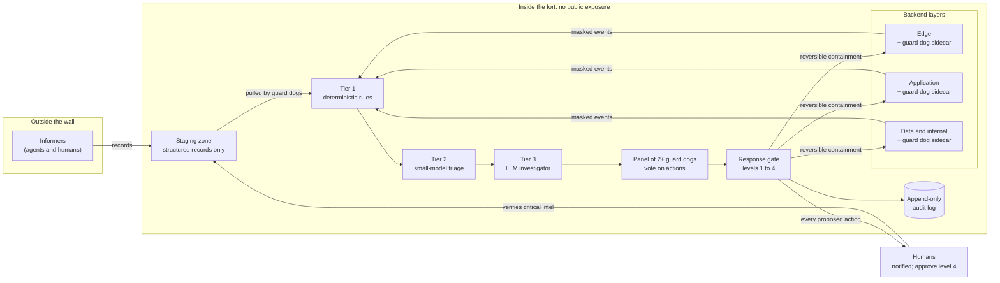

<p align="center">
  
</p>

<h1 align="center">Guard Dogs</h1>

<p align="center">An active patrol layer for web runtimes (Node, PHP) in the AI-attacker era.</p>

> **Status: early research prototype (v0.0.1).** This is a scaffold: shared schemas and three small, tested building blocks. It is not a product, it does not protect anything yet, and the interfaces will change.

## The idea

Patching is the real fix, and nothing here replaces it. But patches take time to ship and deploy, and AI-assisted attackers can turn a disclosure into exploit attempts quickly. Most defences are passive: they wait for a request to match a signature.

A **guard dog** is different. It is a small agent that runs as a **sidecar on every backend layer**, patrols continuously, and looks for discrepancies:

- **Exposure patrol**: what is installed, and does any trusted advisory say it is vulnerable?
- **Drift patrol**: do web roots, processes, outbound calls, LLM API calls and MCP tooling still match the baseline?
- **Probe patrol**: can the system be fooled the way an attacker would try? (Planned, simulated and inert traffic only.)

Where a layer is already protected (a WAF, an API gateway), the guard dog watches that control's logs and **acts only on a discrepancy**, through the control's own rule interface and only in a time-boxed, reversible way. Where a layer has no control, it acts as the control.

## Design principles

| Principle | What it means here |
| --- | --- |
| Tiered detection | Tier 1 deterministic rules, tier 2 small-model triage, tier 3 LLM investigator. Higher tiers see less volume and cost more. |
| Investigators propose, never execute | A response gate executes. At least two guard dogs patrol as a panel, and a **majority of the whole panel** must agree before any containment (2 of 2, 2 of 3, 3 of 5, 4 of 7). If too few agree to act but a sizeable minority flagged it, nothing runs and a human is alerted anyway. |
| Graduated response | 1 observe, 2 alert, 3 contain (reversible, expiring), 4 contain (disruptive, human approval). Every proposed action notifies a human. |
| The fort | Guard dogs are never publicly exposed. They pull from a staging zone; nothing is pushed in. Egress is allow-listed. |
| Informers | Agents and humans outside the wall emit **structured records only**. Critical intel needs human verification before guard dogs act on it. |
| Mask first | Logs are masked before any model call. Hosted model APIs to start; self-host if data sovereignty matters. |
| Guard dogs are targets | Prompt injection through logs, forged advisories, over-privilege and audit tampering are in the threat model from day one. |

See [docs/design.md](docs/design.md) for the rules the code already enforces.

## Architecture



## What is in this repository

| Path | What it is | Status |
| --- | --- | --- |
| `schemas/` | Language-neutral JSON Schemas: events, informer records, proposed actions, audit entries. A PHP sidecar can use the same files. | Draft v0 |
| `src/exposure/matcher.ts` | **Advisory matcher.** Matches informer records against the inventory. Validates records at the trust boundary, enforces the source allow-list, and caps the response level for unverified intel. | Tested |
| `src/rules/` | **Tier 1 rules engine.** Three drift rules (executable in a web root, unexpected outbound host, web process spawning a shell) with sanitised evidence. | Tested |
| `src/audit/log.ts` | **Audit log.** Append-only, hash-chained JSONL with tamper detection and external anchoring. | Tested |
| `src/masking/` | **Log masking.** Removes secrets, tokens, emails and card numbers, and replaces client IPs with keyed pseudonyms, before an event reaches tier 1 or any model. Only `maskEvent` produces `masked: true`. | Tested |
| `src/gate/` | **Response gate.** Decides what happens to a proposed action: run, wait for a human, or deny. Enforces the response levels, panel voting with distinct members and models, pre-approved scopes, protected targets, intel ceilings, and human approvals tied to the exact action. It executes nothing itself. | Tested |
| `src/panel/` | **Panel runner.** Puts a case to every guard dog on the panel in parallel, each with its own evidence view, under one deadline. A dog that is slow, fails or answers nonsense is an abstention, not a yes. Stops early only when no outstanding vote could change the gate's verdict. Votes attach only to the exact action that was reviewed. The dogs themselves plug in through a small interface. | Tested |
| `src/models/` | **Model registry and panel planner.** The only models a guard dog may call, each with one validated HTTPS endpoint. Plans which model sits behind which seat (providers and families spread, data handling per view), derives the egress allow-list from the models in use, and reports what a panel depends on. Configuration decides; a dog or the evidence never does. | Tested |
| `src/dogs/` | **Model-backed guard dogs.** A `ModelDog` asks one registered model for its vote. Adapters for the Anthropic Messages API, the Gemini API and any OpenAI-compatible server (which covers self-hosted models). Evidence goes to the model as delimited JSON data, the reply must be exactly one JSON vote or it counts as an abstention, and an approval on evidence that was cut short becomes an abstention. A client can only call the endpoint the registry holds for its model, never follows a redirect, caps the answer size, and never puts a key, a response body or the evidence in an error. | Tested against fakes; not run against live services |
| `src/dogs/triage.ts` | **Tier 2 triage.** A small model, or up to three of different families, reads the flags tier 1 raised and decides which deserve a full investigation. It can only raise attention: its only outputs are escalate and routine, an alert has already gone to a human either way, any one model can escalate, and an item is dismissed only if every model saw all of it and said so. Models that fail, time out or answer nonsense get the fallback (escalate by default). | Tested against fakes; not run against live services |
| `src/dogs/investigator.ts` | **Tier 3 investigator.** A large model reads one escalated case and either says "none" or proposes one containment. It only picks: the target and kind must come from a list the case supplies, the evidence it cites must be evidence it was shown, and code sets the level, the expiry, the reversible flag, the proposer and a stable id. A made-up target, kind or evidence id refuses the whole proposal. The panel votes on what it proposes. | Tested against fakes; not run against live services |
| `src/orchestrator/` | **The orchestrator.** One cycle from flagged events to submitted proposals: group the pipeline's hits into incidents, let triage drop the routine ones, build a case from targets the deployer names, ask the investigators, put what they propose to the panel, submit it with the votes. A budget caps how many investigations a window may start and says so once when it is spent. Failures stay with the step that had them. | Tested end to end against fake models; not run against live services |
| `src/executor/` | **Executor.** The only way a proposal becomes a change. Audits before acting and fails closed, expires and reverts containment, limits how much automatic containment can run, refuses a repeated action id, and recovers its state from the audit log after a restart. Real controls plug in as adapters. | Tested |
| `src/pipeline/` | **Sidecar pipeline.** Takes raw events and staged informer records and runs them through masking, tier 1, alert throttling and the executor. Caps how many different alerts go out per window, so fabricated events cannot bury a real alert. Gives the gate a per-proposal snapshot of the evidence it may cite. Includes a bounded JSONL reader. | Tested |
| `examples/demo.ts` | **Offline demo.** The whole flow end to end with scripted stand-in dogs. Also run by the tests. | Tested |
| `fixtures/` | Synthetic records, events and actions. Nothing here is a real advisory or a working exploit. | |

Not built yet: the sidecar processes themselves (tailing logs and shipping events to the pipeline), the probe patrol, and the evaluation testbed.

## Quick start

Requires Node 22 or newer.

```sh
npm install
npm run check   # typecheck and run the tests
npm run build
```

Try the whole thing offline:

```sh
npm run demo
```

Nothing calls a model or the network. The guard dogs in the demo are scripted stand-ins whose votes are set per scene; the model registry and planner, masking, throttling, triage, investigator, orchestrator, panel runner, response gate, executor, human approval and expiry are the real code, and in the scene that runs the whole chain the triage and investigator models are scripted replies that go through the real prompts and parsers. It walks through a burst of webshell uploads becoming one alert, four of seven dogs agreeing and the rest being stopped, three against four being rejected while a human is still told, two silent dogs sending a decision to a person, the whole chain from flagged events to an applied containment with no hand-fed proposal, and containment expiring. The tests run it too, so it cannot drift from the code.

Use real models. You choose the models and say how to reach each one; the dogs only ever call those.

```ts
import { Panel, createGatePolicy, createModelDogs, createModelRegistry, planPanel } from 'guard-dogs';

const registry = createModelRegistry([
  { id: 'claude-large', provider: 'anthropic', family: 'claude', tier: 'large', handling: 'zero-retention', maxInputChars: 40_000,
    endpoint: 'https://api.anthropic.com/v1/messages' },
  { id: 'gemini-large', provider: 'google', family: 'gemini', tier: 'large', handling: 'zero-retention', maxInputChars: 40_000,
    endpoint: 'https://generativelanguage.googleapis.com/v1beta/models/<model>:generateContent' },
  { id: 'local-large', provider: 'selfhosted', family: 'open', tier: 'large', handling: 'self-hosted', maxInputChars: 40_000,
    endpoint: 'https://llm.internal.example/v1/chat/completions' },
]);

const policy = createGatePolicy({ panel: planPanel(registry, { size: 3, views: ['raw-logs', 'summaries', 'timeline'] }), /* ... */ });

const dogs = createModelDogs(policy, registry, {
  'claude-large': { protocol: 'anthropic', apiModel: '<model name>', apiKey: () => process.env['ANTHROPIC_API_KEY'] as string },
  'gemini-large': { protocol: 'gemini', apiKey: () => process.env['GEMINI_API_KEY'] as string }, // the model is in the endpoint
  'local-large': { protocol: 'openai-compatible', apiModel: '<model name>', apiKey: () => process.env['LOCAL_LLM_KEY'] as string },
});

const review = await new Panel({ policy, dogs }).review({ action, evidence });
```

The library never reads the environment; pass keys from your secret store. Put `registry.egressHosts()` in `RulesConfig.guardDogEgress`.

Example: match an advisory against what you run.

```ts
import { matchAdvisories } from 'guard-dogs';

const { findings, rejected } = matchAdvisories(
  [{ ecosystem: 'npm', name: 'example-lib', version: '1.2.0', service: 'shop-web', layer: 'application' }],
  recordsFromStagingZone, // unknown[]: validated, never trusted
  { allowedSources: new Set(['example-advisory-feed']) },
);
// An unverified critical record yields maxLevel 2 (alert) and needsHumanVerification: true.
```

## Limits to be honest about

- Masking is pattern-based. It favours over-masking, but it cannot recognise every secret format, names, phone numbers or free-text personal data. Treat it as one layer: keep secrets out of logs at the source too.
- The panel stops waiting for a dog that ignores its abort signal, but cannot stop it. A real dog must pass the signal to its HTTP client, or it keeps running (and billing) in the background.
- Tier 1 rules are starting points, not a complete baseline. Real services will need per-service baselines and allow-lists, and they will produce false positives until tuned.
- The audit log detects tampering in the middle of the chain. Detecting a removed tail or a rewritten chain needs an anchor stored where the writer cannot reach.
- Sanitising evidence is hygiene, not a defence against prompt injection. Anything sent to a model must still be delimited and treated as data.
- The model adapters follow each provider's documented request format and are tested against fakes, plus a real local server for the redirect, size and timeout behaviour. They have not been run against the live services, which the build environment cannot reach. Try each with a real key and a throwaway panel before relying on it.
- The prompt and the strict reply parsing make prompt injection harder, not impossible. What bounds the damage is the rest of the design: a majority across models, reversible and expiring actions, and a human told about anything contested.
- Alerts are throttled by rule and service. One alert per window can stand for many events; the suppressed counts are reported on the next alert and in the audit log, but a quiet repeat is not individually notified.
- The pipeline trusts the staging zone's integrity. If something can write there, it can choose which copy of an advisory record the pipeline sees last. Protect that directory like the audit log.
- Waiting proposals live in memory. After a restart the investigators propose again.
- Ranges are matched with semver rules. Composer versions that are not semver-like are coerced and may match imprecisely.

## Safety and scope

This project is defensive. Contributions must not include working exploits. Testing uses simulated, inert traffic in an isolated environment. See [CONTRIBUTING.md](CONTRIBUTING.md) and [SECURITY.md](SECURITY.md).

## License

Apache-2.0. See [LICENSE](LICENSE).

## Citing

See [CITATION.cff](CITATION.cff).
